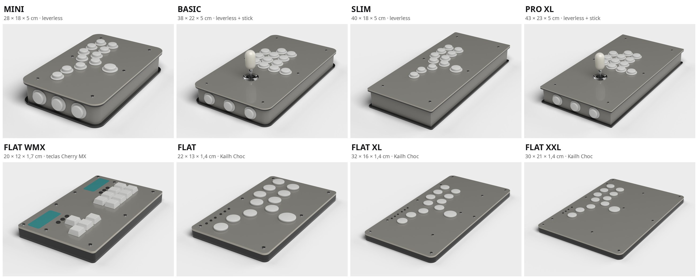

# Arcade Builder

Ferramentas para planejar a arte de um controle arcade antes de mandar fazer:
um editor que roda no navegador e modelos 3D no Blender dos controles da
[Ultra Arcade BH](https://ultraarcadebh.com.br/arcade-builder/).

## Ateliê do Controle (editor)

O editor está em [`index.html`](index.html). É um arquivo só, sem build.

- Escolha o modelo (MINI, BASIC, SLIM, PRO XL e a linha FLAT) e um dos 36 layouts do montador da loja.
- Suba a arte do topo, das pontas e da frente/fundo. Arraste para posicionar, use zoom, gire ou espelhe.
- Veja o resultado em 3D, com os furos dos botões, do stick e dos parafusos no lugar certo.
- Pinte cada botão com as cores Sanwa (ou as capas low-profile da linha FLAT) e escolha a cor do bat-top.
- Baixe os PNGs em 300 DPI prontos para a gráfica, num `.zip` com um `LEIA-ME.txt` que traz as medidas e a lista de botões.

### Como usar

Abra o `index.html` no navegador. Ele precisa de internet para carregar o
three.js e o JSZip (do cdnjs) e as fontes (do Google Fonts).

Para usar online, ative o GitHub Pages em **Settings → Pages → Deploy from a
branch → `main` / root**. O editor fica em
`https://<usuario>.github.io/Arcade-Builder/`.

As imagens e os ajustes ficam salvos só no seu navegador (IndexedDB). Nada é
enviado para nenhum servidor.

## Modelos 3D (Blender)

| Pasta | O que tem |
| --- | --- |
| [`modelos-ultra-arcade/blender/`](modelos-ultra-arcade/blender/) | Os 8 modelos da loja, um `.blend` cada, mais `todos-os-modelos.blend` com todos lado a lado |
| [`modelos-ultra-arcade/previas/`](modelos-ultra-arcade/previas/) | Render de cada modelo |
| [`modelo-novo/final/`](modelo-novo/final/) | PRO XL com layout hitbox, 12 botões de 30 mm, stick bat-top e 6 botões laterais |
| [`modelo-novo/versoes-anteriores/`](modelo-novo/versoes-anteriores/) | Versões anteriores do mesmo controle |

Os arquivos foram salvos no Blender 5.2 e renderizam em Cycles com a
câmera já posicionada. Medidas em milímetros, tiradas dos dados públicos do
montador da loja. O case tem 50 mm de altura no total. As paredes têm 40 mm e
ficam 6 mm para dentro das placas de acrílico. Esse recuo é uma estimativa,
então confirme com a loja antes de imprimir.

### Colocando a sua arte

Os modelos vêm com uma textura cinza neutra (`sem-arte.png`) no lugar das artes.
Para testar a sua:

1. Abra o `.blend` e vá na aba **Shading**.
2. Selecione o material da superfície:
   - modelos da loja: `arte_topo`, `arte_pontas` e `arte_frente_fundo`;
   - `modelo-novo`: `top_art`, `side_art` e `front_art`.
3. No nó **Image Texture**, troque `sem-arte.png` pela sua imagem.

Os PNGs exportados pelo editor já saem no tamanho e na proporção de cada
superfície.

## Aviso

Projeto pessoal, sem ligação com a Ultra Arcade BH. Os nomes dos modelos e as
medidas são os do montador público da loja. Confirme tudo com ela antes de
encomendar.
